# Create Intelligent Power Apps and Power Automate Workflows with Copilot — Learner Guide

**WSQ Course Code:** TGS-2023036648  |  **Conducted by:** Tertiary Infotech Academy Pte Ltd (UEN 201200696W)  |  **Version v12.0 · 2 September 2026**

## Contents

- [Introduction](#introduction)
- [Course Learning Outcomes](#course-learning-outcomes)
- [Skills Framework Alignment](#skills-framework-alignment)
- [Before You Start — Environment Setup](#before-you-start--environment-setup)
- [LU1 — Get Started with Copilot for Microsoft Power Platform](#lu1--get-started-with-copilot-for-microsoft-power-platform)
  - [Lab 1 — Validate the Lab Environment and Explore Copilot](#lab-1--validate-the-lab-environment-and-explore-copilot)
  - [Lab 2 — Use Copilot to Build a Canvas App from a Description](#lab-2--use-copilot-to-build-a-canvas-app-from-a-description)
  - [Lab 3 — Build a Cloud Flow with Copilot for Power Automate](#lab-3--build-a-cloud-flow-with-copilot-for-power-automate)
  - [Lab 4 — Use Copilot to Build a Power Pages Site](#lab-4--use-copilot-to-build-a-power-pages-site)
- [LU2 — Create and Manage Canvas Apps with Power Apps](#lu2--create-and-manage-canvas-apps-with-power-apps)
  - [Lab 5 — Create a Canvas App from Excel Data](#lab-5--create-a-canvas-app-from-excel-data)
  - [Lab 6 — Build the Dataverse Data Model](#lab-6--build-the-dataverse-data-model)
  - [Lab 7 — Create a Canvas App over Dataverse](#lab-7--create-a-canvas-app-over-dataverse)
  - [Lab 8 — Build and Theme the User Interface](#lab-8--build-and-theme-the-user-interface)
  - [Lab 9 — Work with External Data — SharePoint, Collections and Patch](#lab-9--work-with-external-data--sharepoint-collections-and-patch)
  - [Lab 10 — Write Data with Forms](#lab-10--write-data-with-forms)
  - [Lab 11 — Extend the App with a Code Component (PCF)](#lab-11--extend-the-app-with-a-code-component-pcf)
  - [Lab 12 — Publish, Share and Maintain the App](#lab-12--publish-share-and-maintain-the-app)
- [LU3 — Create and Manage Automated Processes with Power Automate and Copilot Studio Agents](#lu3--create-and-manage-automated-processes-with-power-automate-and-copilot-studio-agents)
  - [Lab 13 — Create Cloud Flows — Template, Copilot and Blank](#lab-13--create-cloud-flows--template-copilot-and-blank)
  - [Lab 14 — Build an Approval Flow with a Human in the Loop](#lab-14--build-an-approval-flow-with-a-human-in-the-loop)
  - [Lab 15 — Button Flows and Scheduled Flows](#lab-15--button-flows-and-scheduled-flows)
  - [Lab 16 — Trigger Filters and Cross-Source Integration](#lab-16--trigger-filters-and-cross-source-integration)
  - [Lab 17 — Build Your First Copilot Studio Agent](#lab-17--build-your-first-copilot-studio-agent)
  - [Lab 18 — Give the Agent a Tool — Calling a Workflow from an Agent](#lab-18--give-the-agent-a-tool--calling-a-workflow-from-an-agent)
  - [Lab 19 — Call an Agent from a Workflow with Structured Output](#lab-19--call-an-agent-from-a-workflow-with-structured-output)
  - [Lab 20 — Multi-Agent Handoff and a Human Review Gate](#lab-20--multi-agent-handoff-and-a-human-review-gate)
- [LU4 — Create and Manage Model-Driven Apps with Power Apps and Dataverse](#lu4--create-and-manage-model-driven-apps-with-power-apps-and-dataverse)
  - [Lab 21 — Create Dataverse Tables for a Model-Driven App](#lab-21--create-dataverse-tables-for-a-model-driven-app)
  - [Lab 22 — Build a Model-Driven App](#lab-22--build-a-model-driven-app)
  - [Lab 23 — Configure Forms and Views](#lab-23--configure-forms-and-views)
  - [Lab 24 — Create Charts and Dashboards](#lab-24--create-charts-and-dashboards)
  - [Lab 25 — Manage Solutions and Move to Another Environment](#lab-25--manage-solutions-and-move-to-another-environment)
  - [Lab 26 — Troubleshoot and Modify Power Platform Integrations](#lab-26--troubleshoot-and-modify-power-platform-integrations)
- [Troubleshooting Reference](#troubleshooting-reference)
- [Assessment Preparation](#assessment-preparation)
- [Glossary](#glossary)


## Introduction

This Learner Guide accompanies the WSQ course Create Intelligent Power Apps and Power Automate Workflows with Copilot (TGS-2023036648), conducted by Tertiary Infotech Academy Pte Ltd. It provides the full step-by-step instructions for all 26 hands-on labs, organised by the four Learning Units of the course. Every lab maps to an ability or knowledge item of the Skills Framework TSC Applications Integration (ICT-DIT-3003-1.1), and is completed in the Microsoft Power Platform: the Power Apps maker portal, Power Automate, Copilot Studio and Microsoft Dataverse.

Use this guide alongside the course slides. The slides teach the concepts and show the product interfaces; THIS guide carries the click-by-click procedure. Each lab also has its own folder under labs/ containing the same steps plus the mock data files the lab needs, so you can work from either the guide or the lab folder.

> **Note:** The slide deck deliberately contains no step-by-step procedures. If you are looking for the exact sequence of clicks, it is here in the Learner Guide and in labs/lab-NN-*/README.md.


## Course Learning Outcomes

- LO1: Identify opportunities for creating connections in Microsoft Power Platform and perform feasibility scans.
- LO2: Utilise Power Apps to integrate data and functions across programs and API-level integration.
- LO3: Execute tests in Power Automate to verify the connections between disparate programs and their functioning across platforms.
- LO4: Resolve technical issues in Power Platforms and implement modifications to Power Platform middleware.


## Skills Framework Alignment

TSC Title: Applications Integration   ·   TSC Code: ICT-DIT-3003-1.1

**Abilities assessed**

- A1: Identify opportunities for creating connections among various devices, databases, software and applications
- A2: Perform feasibility scan and assessment to identify potential middleware to be used
- A3: Utilise middleware to integrate data and functions across application programs within an enterprise
- A4: Support API-level integration
- A5: Perform tests and checks on the connections between disparate application programs
- A6: Verify proper functioning of modules and applications across multiple or integrated platforms
- A7: Highlight technical, compatibility or performance issues following integration of applications or platforms
- A8: Implement modifications to middleware or the programming process to enhance integration and connections

**Knowledge assessed**

- K1: Types of middleware and their features
- K2: Proper usage of middleware
- K3: Different types of platforms on which applications run
- K4: Potential technical, compatibility or performance issues in application integration
- K5: Functions of Application Programming Interfaces (APIs)


## Before You Start — Environment Setup

**What you need**

- A Microsoft 365 training account issued by the trainer, with a Power Platform licence (or a Developer Plan environment).
- Access to ONE environment (for example 'Dev One') with a Dataverse database provisioned. Every lab uses the same environment.
- A modern browser. The labs use make.powerapps.com, make.powerautomate.com, copilotstudio.microsoft.com and make.powerpages.microsoft.com.
- For Lab 11 only: Node.js LTS, the .NET SDK and the Power Platform CLI (pac) installed locally.
- OneDrive for Business and a SharePoint site you can create lists in.

**The single most important setting**

Confirm the environment picker at the top right of EVERY portal shows the same environment before you build anything. Apps, flows, tables and agents can only see each other inside one environment. A flow built in the wrong environment is invisible to your agent, and this is the most common cause of 'it disappeared' during this course.

**Verify the Power Platform CLI (Lab 11 only)**

```bash
pac --version           # Power Platform CLI
node --version          # Node.js LTS
dotnet --version        # .NET SDK
```

**Conventions used in every lab**

- Each lab has its own folder: labs/lab-NN-<slug>/ with a README.md and a mock-data/ subfolder.
- Import the CSV files from mock-data/ rather than inventing your own data — later labs verify against these exact values.
- Power Fx formulas are shown exactly as they must be typed into the formula bar.
- In Power Automate, always insert values with Dynamic content or the lightning-bolt picker; never type a value another step already produced.
- Trigger filters and Filter Query expressions use the SCHEMA name of a column (e.g. statuscode), not its display name.


## LU1 — Get Started with Copilot for Microsoft Power Platform

Topics 1–4 · Copilot in Power Apps · Power Automate · Power Pages

**Key concepts**

- A copilot is an AI assistant you reach through chat; Microsoft Power Platform ships several, each tailored to the product you are in.
- Copilot for Power Apps turns a natural-language description into a data structure and canvas app pages you then refine.
- Copilot for Power Automate explains, adds and replaces actions in cloud and desktop flows rather than writing them blind.
- Copilot for Power Pages generates theming, standard pages, AI stock images and text for an external-facing website.
- Every copilot shares the same anatomy: compose a prompt, undo modifications, ask for help, show or hide the pane.
- Prompt quality drives output quality — a specific, detailed description of the desired outcome beats a vague request.
- Copilot accelerates prototyping, supplies inspiration and completes tasks; the maker still owns review and correctness.
- Feasibility scanning (TSC A2) means judging whether a Power Platform connector and licence can actually carry the integration.


### Lab 1 — Validate the Lab Environment and Explore Copilot

TSC mapping: A1/A2 — Identify connection opportunities in Power Platform and scan the environment for feasibility.

Goal: Sign in to the Power Apps maker portal, confirm you are in the correct environment, verify that Dataverse and the Copilot features are available, and take an inventory of the connectors your tenant can actually reach.

**What you'll build**

A validated maker environment with a documented connector feasibility scan (mock-data/connector-scan.csv).   (Services used: Power Apps maker portal, Power Platform admin centre, Dataverse, Copilot.)

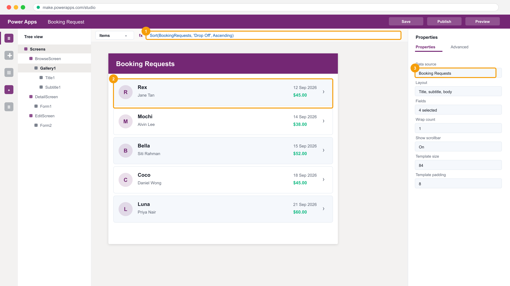

*The Power Apps maker portal and Studio — the tree view, the formula bar and the properties pane.*

**Step-by-step**

1. Open the Power Apps maker portal at make.powerapps.com and sign in with the training account the trainer assigns you.
2. Check the environment picker at the top right — select the Dev One (or trainer-assigned) environment. Every lab in this course uses the same one.
3. Select Tables in the left navigation and confirm Dataverse tables load. If they do not, the environment has no Dataverse database and the trainer must provision one.
4. Select Connections > + New connection and search for Excel Online (Business), SharePoint, Office 365 Users and Outlook. Create each connection.
5. Record each connector's status in mock-data/connector-scan.csv — this is your TSC A2 feasibility scan artefact.
6. Open a blank canvas app and confirm the Copilot pane appears. If it is hidden, enable it from Settings > Updates or the environment's Copilot setting.

**Test it**

Tables load in the chosen environment, all four connections show Connected, and connector-scan.csv records the feasibility result for each.

> **Note:** This lab's folder — labs/lab-01-* — contains the same steps plus the mock data files it needs and three troubleshooting fixes specific to this lab.

---


### Lab 2 — Use Copilot to Build a Canvas App from a Description

TSC mapping: A1/A3 — Use Copilot to turn a natural-language need into a working app over a generated data structure.

Goal: Describe an app in plain English and let Copilot propose a data structure and screens. Iterate on the proposed table, then let Copilot generate the app and inspect what it produced.

**What you'll build**

A Copilot-generated canvas app over a Dataverse table, with the generated data structure reviewed and corrected.   (Services used: Power Apps, Copilot for Power Apps, Dataverse.)

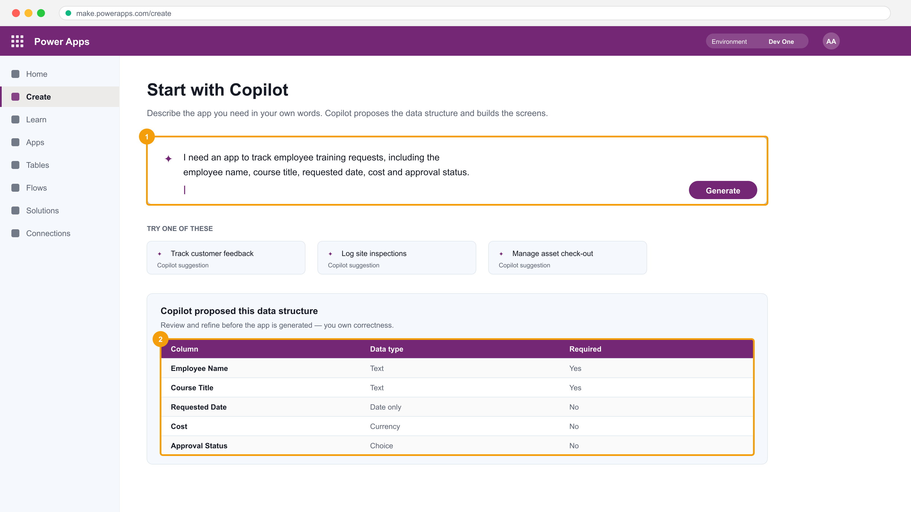

*Copilot in Power Apps: the prompt box, and the data structure it proposes for review.*

**Step-by-step**

1. In make.powerapps.com select + Create, then choose Start with Copilot (the 'Describe it to design it' box).
2. Enter the prompt: I need an app to track employee training requests, including the employee name, course title, requested date, cost and approval status.
3. Review the data structure Copilot proposes. Rename any column that does not match the business language and set Cost to Currency and Requested Date to Date only.
4. Type a refinement prompt: add a column for the training provider and a Yes/No column for whether the course is WSQ funded.
5. Select Create app and wait for Copilot to generate the screens.
6. Open Preview (F5), add one record from mock-data/training-requests.csv, and confirm the record appears in the gallery.
7. Inspect the generated gallery's Items property to see the Dataverse table Copilot bound for you.

**Test it**

The app opens in Preview, a record added in the form appears in the gallery, and the Dataverse table contains the two columns you added by prompt.

> **Note:** This lab's folder — labs/lab-02-* — contains the same steps plus the mock data files it needs and three troubleshooting fixes specific to this lab.

---


### Lab 3 — Build a Cloud Flow with Copilot for Power Automate

TSC mapping: A3/A5 — Use Copilot to assemble a flow, then read and test what it built.

Goal: Use Copilot in Power Automate to build a flow from a description, then examine the trigger and actions it chose, correct them, and test the run.

**What you'll build**

A working Copilot-built cloud flow that emails a summary when a new item is created.   (Services used: Power Automate, Copilot for Power Automate, Outlook, SharePoint.)

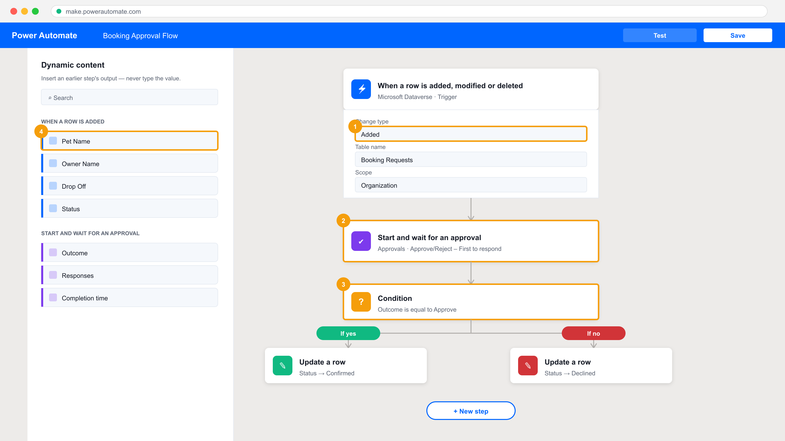

*The Power Automate designer — trigger, actions, and the Dynamic content panel.*

**Step-by-step**

1. Open make.powerautomate.com and confirm you are in the same environment you used in Lab 1.
2. On the home page, enter the Copilot prompt: When a new item is created in a SharePoint list, send me an email with the item details.
3. Review the flow Copilot drafts. Confirm the trigger is 'When an item is created' and the action is 'Send an email (V2)'.
4. Select each step and supply the connection, the SharePoint site address and the list name from Lab 5's list (or the trainer's demo list).
5. Ask Copilot in the side pane: add a step to post a message to Microsoft Teams as well — and inspect the action it inserts.
6. Save the flow, then select Test > Manually and create a list item to fire the trigger.
7. Open the run in Run history and read the inputs and outputs of every action — this is the TSC A5 verification evidence.

**Test it**

The run history shows a Succeeded run, the email arrives with the item's field values, and you can point at the action output that supplied each value.

> **Note:** This lab's folder — labs/lab-03-* — contains the same steps plus the mock data files it needs and three troubleshooting fixes specific to this lab.

---


### Lab 4 — Use Copilot to Build a Power Pages Site

TSC mapping: A1/A4 — Generate an external-facing site and connect it to Dataverse data through its API layer.

Goal: Describe a public-facing site to Copilot in Power Pages, review the theming, pages and AI-generated content it produces, then add a Dataverse-backed form so the site reads and writes real data.

**What you'll build**

A published Power Pages site with a Dataverse-backed page and a working form.   (Services used: Power Pages, Copilot for Power Pages, Dataverse.)

**Step-by-step**

1. Open make.powerpages.microsoft.com and select + Create a site.
2. Describe the site to Copilot: a site where staff can browse available training courses and submit a request to attend.
3. Review the pages, theme and AI-generated images Copilot proposes; edit the site name and the hero heading.
4. Select Edit site, then use the Data workspace to add a list bound to the Dataverse table you created in Lab 2.
5. Add a form component to the request page bound to the same table, and set its mode to Insert.
6. Set the page permissions so anonymous users can read the course list but must sign in to submit a request.
7. Preview the site and submit one request; confirm the row lands in the Dataverse table.

**Test it**

The previewed site lists courses from Dataverse and a submitted request creates a new row in the Dataverse table.

> **Note:** This lab's folder — labs/lab-04-* — contains the same steps plus the mock data files it needs and three troubleshooting fixes specific to this lab.

---


## LU2 — Create and Manage Canvas Apps with Power Apps

Topics 5–10 · PL-7001 · Data · UI · External data · Forms · Publish

**Key concepts**

- A canvas app is a pixel-precise UI you compose from controls and bind to data with Excel-like formulas.
- Power Fx formulas are declarative: a property is an expression that recalculates, never a sequence of statements.
- Dataverse is the managed data platform — tables, columns, relationships and keys — behind Power Platform apps.
- Galleries display many records; Forms display and edit one record; both bind to an Items or DataSource property.
- Navigate() moves between screens; Patch() writes a single record; SubmitForm() commits a Form's changes.
- Connectors (Excel Online, SharePoint, Office 365 Users, SQL) are the middleware that carries data into the app (TSC A3).
- Collections (ClearCollect) hold in-memory data client-side; delegation decides what work the server can do.
- Publishing, sharing and versioning turn a maker's app into a governed asset other people can rely on.


### Lab 5 — Create a Canvas App from Excel Data

TSC mapping: A3 — Utilise a connector as middleware to integrate Excel data into an application.

Goal: Upload an Excel workbook to OneDrive for Business, connect Power Apps to its table through the Excel Online (Business) connector, and generate a three-screen canvas app from that data.

**What you'll build**

A three-screen canvas app (browse, detail, edit) over an Excel table in OneDrive.   (Services used: Power Apps, Excel Online (Business), OneDrive for Business.)


*Power Apps Studio with a gallery bound to a data source.*

**Step-by-step**

1. Open mock-data/CoffeeMachineData.xlsx from the lab folder and note the named table inside it — Power Apps can only bind to a formatted Excel table.
2. In the Power Apps maker portal select the App launcher, open OneDrive, then + Create or upload > Files upload and upload CoffeeMachineData.xlsx.
3. Return to make.powerapps.com, confirm the Dev One environment, and select + Create.
4. Choose the Excel Online (Business) tile under Start from data; a connection is created for you.
5. Expand OneDrive for Business > OneDrive > CoffeeMachineData.xlsx and select the table inside the workbook, then Create app.
6. Wait for the three generated screens — BrowseScreen1, DetailScreen1 and EditScreen1 — and rename the app Coffee Machines.
7. Press F5 to preview, select a record to open the detail screen, then edit and save it.
8. Reopen the workbook in OneDrive and confirm your edit was written back to the Excel row.

**Test it**

The app previews with data from Excel, and an edit made in the app appears in the Excel workbook in OneDrive.

> **Note:** This lab's folder — labs/lab-05-* — contains the same steps plus the mock data files it needs and three troubleshooting fixes specific to this lab.

---


### Lab 6 — Build the Dataverse Data Model

TSC mapping: A1/A3 — Design tables, columns and a relationship as the integration point for apps and flows.

Goal: Create a Booking Request table in Dataverse with typed columns, then create a second table and join them with a lookup column so one row can reference another.

**What you'll build**

Two related Dataverse tables with a lookup relationship and seeded rows.   (Services used: Power Apps, Microsoft Dataverse.)

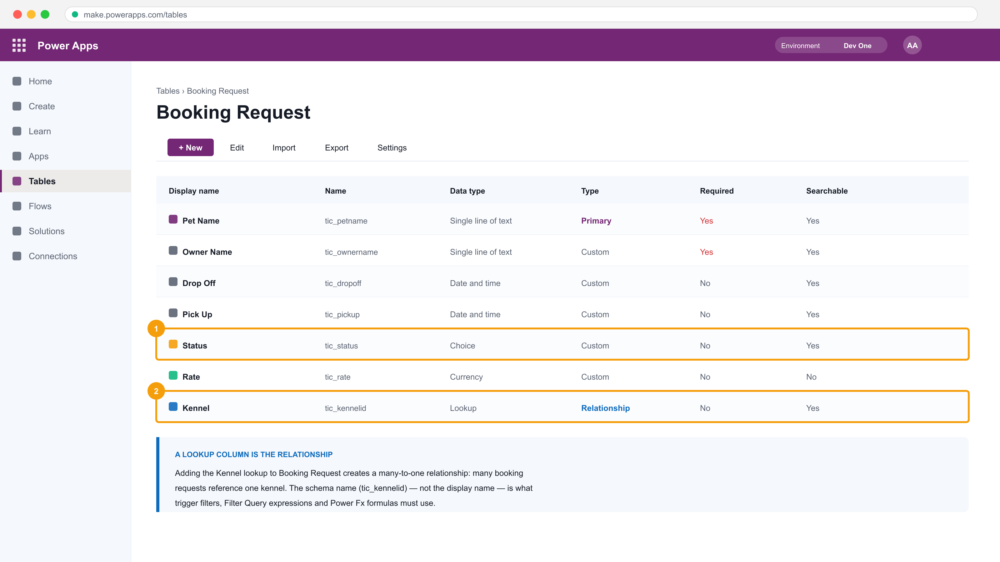

*The Dataverse table designer — typed columns, a Choice column and the Lookup that IS the relationship.*

**Step-by-step**

1. In make.powerapps.com select Tables > + New table > Table (advanced properties).
2. Enter Booking Request as the Display name; on the Primary column tab enter Pet Name, then Save.
3. Add a column Owner Name — Single line of text — and set Required to Business required.
4. Add Drop Off — Date and time, and Pick Up — Date and time.
5. Add a Choice column Status with the options Requested, Confirmed and Declined, default Requested.
6. Create a second table Kennel with the primary column Kennel Name and a Whole number column Capacity.
7. In Booking Request add a Lookup column named Kennel that points at the Kennel table — this is the relationship.
8. Open each table's Data tab and import the rows from mock-data/booking-requests.csv and mock-data/kennels.csv.

**Test it**

Booking Request shows the imported rows, the Status choice renders as a dropdown, and the Kennel lookup resolves to a Kennel row.

> **Note:** This lab's folder — labs/lab-06-* — contains the same steps plus the mock data files it needs and three troubleshooting fixes specific to this lab.

---


### Lab 7 — Create a Canvas App over Dataverse

TSC mapping: A3 — Bind a hand-built canvas app to Dataverse and format the data it displays.

Goal: Build a canvas app from blank, add Dataverse as a data source, lay out the main screen and add a gallery bound to the Booking Request table with formatted fields.

**What you'll build**

A canvas app with a formatted, sorted gallery over the Booking Request table.   (Services used: Power Apps, Microsoft Dataverse, Power Fx.)


*The gallery's Items property in the formula bar, bound to the Dataverse table.*

**Step-by-step**

1. Select + Create > Blank app > Blank canvas app, name it Booking Request, choose Tablet format and Create.
2. On the Data pane select + Add data, search for Booking Request and add the Dataverse table.
3. Insert a Label at the top of the screen; set its Text property to "Booking Requests" and increase the font size.
4. Insert a Vertical gallery and set its Items property to the Booking Request table.

   ```bash
   Sort(BookingRequests, 'Drop Off', Ascending)
   ```

5. Set the gallery layout to Title, subtitle and body, then map Title to Pet Name and Subtitle to Owner Name.
6. Add a Label inside the gallery template for the drop-off date and format it.

   ```bash
   Text(ThisItem.'Drop Off', "dd mmm yyyy")
   ```

7. Add a Label showing the daily rate formatted as currency.

   ```bash
   Text(ThisItem.Rate, "[$-en-US]$#,##0.00")
   ```

8. Preview the app and confirm the gallery lists every seeded booking in drop-off order.

**Test it**

The gallery lists the Dataverse rows sorted by drop-off date, with dates and currency correctly formatted.

> **Note:** This lab's folder — labs/lab-07-* — contains the same steps plus the mock data files it needs and three troubleshooting fixes specific to this lab.

---


### Lab 8 — Build and Theme the User Interface

TSC mapping: A3/A6 — Build a consistent, branded UI and verify it renders correctly across screens.

Goal: Apply a theme to the app, brand individual controls, and personalise the screen with the signed-in user's details from the Office 365 Users connector.

**What you'll build**

A themed, branded canvas app that greets the signed-in user by name.   (Services used: Power Apps, Power Fx, Office 365 Users.)

**Step-by-step**

1. Open the Booking Request app for editing and select Settings > Theme; choose a theme and observe every control restyle.
2. Select the header label and set Fill, Color and Font individually to override the theme for that control.
3. Insert an Icon (for example the Home icon) into the header and set its Color to match the brand colour.
4. Add the Office 365 Users connector from the Data pane.
5. Insert a Label for the greeting and set its Text property to use the signed-in user's given name.

   ```bash
   "Welcome, " & User().FullName
   ```

6. Insert an Image control and bind it to the signed-in user's photo.

   ```bash
   Office365Users.UserPhotoV2(User().Email)
   ```

7. Group the header controls and set their X/Y so the layout holds when the screen resizes.
8. Preview and confirm the greeting and photo resolve for your training account.

**Test it**

The app opens themed and branded, and the header greets the signed-in user by name with their profile photo.

> **Note:** This lab's folder — labs/lab-08-* — contains the same steps plus the mock data files it needs and three troubleshooting fixes specific to this lab.

---


### Lab 9 — Work with External Data — SharePoint, Collections and Patch

TSC mapping: A3/A4 — Integrate a second data source and write to it through API-level functions.

Goal: Create a SharePoint list, add it to the app as a second data source, load data into an in-memory collection, and use Patch to write status changes back to the list.

**What you'll build**

A canvas app reading and writing both Dataverse and a SharePoint list, using a collection and Patch.   (Services used: Power Apps, SharePoint Online, Power Fx, Office 365 Users.)

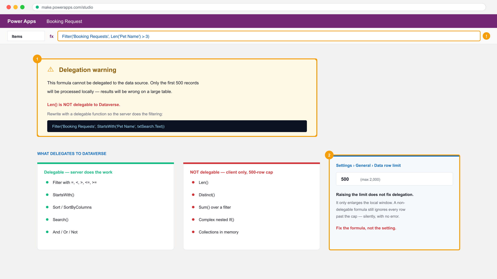

*The delegation warning — the formula processes only the first 500 rows, silently.*

**Step-by-step**

1. In Microsoft 365 create a SharePoint team site named Pet Boarding, then create a list named Kennel Bookings.
2. Add the columns Pet Name (text), Owner (text), Status (choice: Requested/Confirmed/Declined) and Rate (currency); import mock-data/kennel-bookings.csv.
3. In the canvas app select + Add data > SharePoint, supply the site URL and select the Kennel Bookings list.
4. Insert a second gallery and set its Items to the SharePoint list.

   ```bash
   SortByColumns('Kennel Bookings', "Title", Ascending)
   ```

5. Add a button labelled Load and set its OnSelect to build an in-memory collection.

   ```bash
   ClearCollect(colBookings, 'Kennel Bookings')
   ```

6. Add a Decline button in the gallery template and set OnSelect to patch the selected row's status.

   ```bash
   Patch('Kennel Bookings', ThisItem, {Status: {Value: "Declined"}})
   ```

7. Add a Confirm button that patches the status to Confirmed.

   ```bash
   Patch('Kennel Bookings', ThisItem, {Status: {Value: "Confirmed"}})
   ```

8. Preview, confirm one booking and decline another, then check the SharePoint list to verify both writes.

**Test it**

The SharePoint list shows the status values changed by the Confirm and Decline buttons, and colBookings appears under Variables > Collections.

> **Note:** This lab's folder — labs/lab-09-* — contains the same steps plus the mock data files it needs and three troubleshooting fixes specific to this lab.

---


### Lab 10 — Write Data with Forms

TSC mapping: A3/A5 — Use Form controls to display, edit and create records, and verify each write.

Goal: Add detail and edit screens, wire navigation between them, then use Display and Edit forms with SubmitForm and NewForm to read, update and create Dataverse records.

**What you'll build**

A three-screen app with working display, edit, create and delete behaviour over Dataverse.   (Services used: Power Apps, Microsoft Dataverse, Power Fx.)


*Form and gallery on the canvas, with the properties pane.*

**Step-by-step**

1. Add two screens named DetailScreen and EditScreen to the Booking Request app.
2. On the browse gallery's chevron set OnSelect to open the detail screen for the selected record.

   ```bash
   Navigate(DetailScreen, ScreenTransition.Cover)
   ```

3. On DetailScreen insert a Display form, set DataSource to Booking Request and Item to the gallery's selection.

   ```bash
   Gallery1.Selected
   ```

4. Add an Edit icon whose OnSelect navigates to EditScreen.

   ```bash
   Navigate(EditScreen, ScreenTransition.Cover)
   ```

5. On EditScreen insert an Edit form with the same DataSource and Item, then add a Save button.

   ```bash
   SubmitForm(Form2)
   ```

6. Set the Edit form's OnSuccess to return to the detail screen.

   ```bash
   Back()
   ```

7. Add a + New icon on the browse screen that opens a blank edit form.

   ```bash
   NewForm(Form2); Navigate(EditScreen)
   ```

8. Add a Delete icon on DetailScreen that removes the record and returns.

   ```bash
   Remove('Booking Requests', Gallery1.Selected); Back()
   ```

9. Preview: create a new booking, edit it, then delete it, checking the Dataverse table after each action.

**Test it**

A record created in the app appears in Dataverse, an edit updates the same row, and Delete removes it — verified in the table's Data tab.

> **Note:** This lab's folder — labs/lab-10-* — contains the same steps plus the mock data files it needs and three troubleshooting fixes specific to this lab.

---


### Lab 11 — Extend the App with a Code Component (PCF)

TSC mapping: A4/A8 — Support API-level integration by building a custom control and modifying the platform's UI layer.

Goal: Use the Power Apps Component Framework to build, test and package a custom code component, then import it into the environment and place it on a canvas app screen.

**What you'll build**

A packaged PCF code component imported as a solution and used inside the canvas app.   (Services used: Power Platform CLI, Node.js, TypeScript, Power Apps Component Framework, Dataverse solutions.)

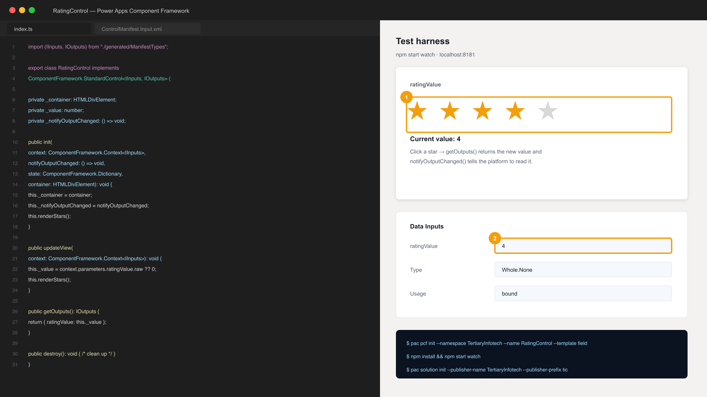

*The PCF code component in the local test harness, with its bound property.*

**Step-by-step**

1. Verify the toolchain is installed — Node.js LTS, .NET SDK and the Power Platform CLI.

   ```bash
   pac --version
   ```

2. Create a folder for the component and scaffold a field-type control.

   ```bash
   mkdir RatingControl && cd RatingControl && pac pcf init --namespace TertiaryInfotech --name RatingControl --template field
   ```

3. Install the npm dependencies the template declares.

   ```bash
   npm install
   ```

4. Open ControlManifest.Input.xml and declare a bound property named ratingValue of type Whole.None, then edit index.ts to render the control.
5. Run the local test harness and interact with the control in the browser.

   ```bash
   npm start watch
   ```

6. Create a solution project alongside the component and add a reference to it.

   ```bash
   pac solution init --publisher-name TertiaryInfotech --publisher-prefix tic
   ```

7. Add the component reference and build the managed solution package.

   ```bash
   pac solution add-reference --path ../RatingControl && dotnet build
   ```

8. Import the generated solution zip from bin/Debug into your environment via make.powerapps.com > Solutions > Import.
9. In the canvas app enable code components in Settings > General, then Insert > Get more components > Code and add RatingControl to a screen.

**Test it**

npm start watch renders the control in the harness, the solution imports without error, and the component can be inserted onto a canvas app screen.

> **Note:** This lab's folder — labs/lab-11-* — contains the same steps plus the mock data files it needs and three troubleshooting fixes specific to this lab.

---


### Lab 12 — Publish, Share and Maintain the App

TSC mapping: A6/A8 — Verify the app functions for other users and manage its versions and permissions.

Goal: Publish the canvas app, share it with colleagues at the right permission level, review and restore versions, and export the app package for another environment.

**What you'll build**

A published, shared and exported canvas app with a documented version history.   (Services used: Power Apps, Microsoft Entra ID, Dataverse.)

**Step-by-step**

1. In the maker portal open Apps, select the Booking Request app and choose Publish, then Publish this version.
2. Select Share, add another training account, and grant Can use (not Co-owner) to test least privilege.
3. Note the data source permission warning — sharing the app does not share the underlying Dataverse rows.
4. Open Details > Versions, review the version list and use Restore to roll back to an earlier version.
5. Select Export package, choose Create as new for the app, and download the .zip package.
6. Record the app's URL from Details and open it in a private browser window signed in as the shared user.
7. Confirm the shared user can open the app and, if their Dataverse permission is missing, capture the error as the TSC A7 issue report.

**Test it**

The published app opens from its own URL for a second signed-in user, the version history shows a restore, and the exported .zip downloads.

> **Note:** This lab's folder — labs/lab-12-* — contains the same steps plus the mock data files it needs and three troubleshooting fixes specific to this lab.

---


## LU3 — Create and Manage Automated Processes with Power Automate and Copilot Studio Agents

Topics 11–14 · PL-7002 · Flows · Approvals · Agents · Integration

**Key concepts**

- Every cloud flow is the same four parts: one trigger, ordered actions, the outputs each action produces, and a result.
- Four trigger families — manual, scheduled, automated and request — each states who or what may start the process.
- Dynamic content inserts an earlier step's output as a token; a typed literal is a constant that will be wrong tomorrow.
- Approvals pause a flow for a person: Start and wait for an approval returns an Outcome the flow then branches on.
- Trigger filters (column and row) stop a flow running at all, which is cheaper and clearer than a Condition inside it.
- The new Copilot Studio separates the AI model (the brain) from the harness (context, tools, governance, workflows).
- An agent has five parts — instructions, skills, knowledge, tools and connected agents — and only some are enforced.
- A workflow is deterministic and fails loudly; an agent chooses its path at run time and fails quietly with confidence.
- Testing a flow (TSC A5/A6) means reading run history: the trigger, each action's inputs and outputs, and the failure point.


### Lab 13 — Create Cloud Flows — Template, Copilot and Blank

TSC mapping: A3/A5 — Build flows three ways and verify each run against its trigger and actions.

Goal: Create one flow from a template, one with Copilot and one from blank, so the trigger-actions-outputs anatomy is visible from three directions, then read the run history of each.

**What you'll build**

Three working cloud flows plus a read of their run history.   (Services used: Power Automate, Outlook, SharePoint, Copilot for Power Automate.)


*Building a cloud flow: one trigger, ordered actions, dynamic content.*

**Step-by-step**

1. Open make.powerautomate.com and confirm you are in the Dev One environment.
2. Select Templates, search for a 'Save Office 365 email attachments to OneDrive' template and create it, supplying each connection.
3. Run the template flow by sending yourself an email with an attachment, then open Run history and read each action's inputs and outputs.
4. On the home page enter a Copilot prompt to draft a second flow: send me an email when a new item is added to my SharePoint list.
5. Select + Create > Automated cloud flow to build the third flow from blank; choose the 'When an item is created' SharePoint trigger.
6. Configure the trigger with the site address and list name, then + New step > Send an email (V2).
7. In the email body use Dynamic content to insert the item's Title and Created By — never type the values.
8. Save and test the blank flow, then compare all three flows' run histories in the Cloud flow activity page.

**Test it**

All three flows show a Succeeded run, and you can name the trigger and each action's output that supplied a value in the email.

> **Note:** This lab's folder — labs/lab-13-* — contains the same steps plus the mock data files it needs and three troubleshooting fixes specific to this lab.

---


### Lab 14 — Build an Approval Flow with a Human in the Loop

TSC mapping: A3/A5 — Pause an automated process for a human decision and branch on the outcome.

Goal: Build a flow that starts when a booking request row is created, sends an approval to a manager, waits for the response, and updates the record's status based on the outcome.

**What you'll build**

An approval flow that writes Confirmed or Declined back to Dataverse based on a human decision.   (Services used: Power Automate, Approvals, Dataverse, Outlook, Microsoft Teams.)

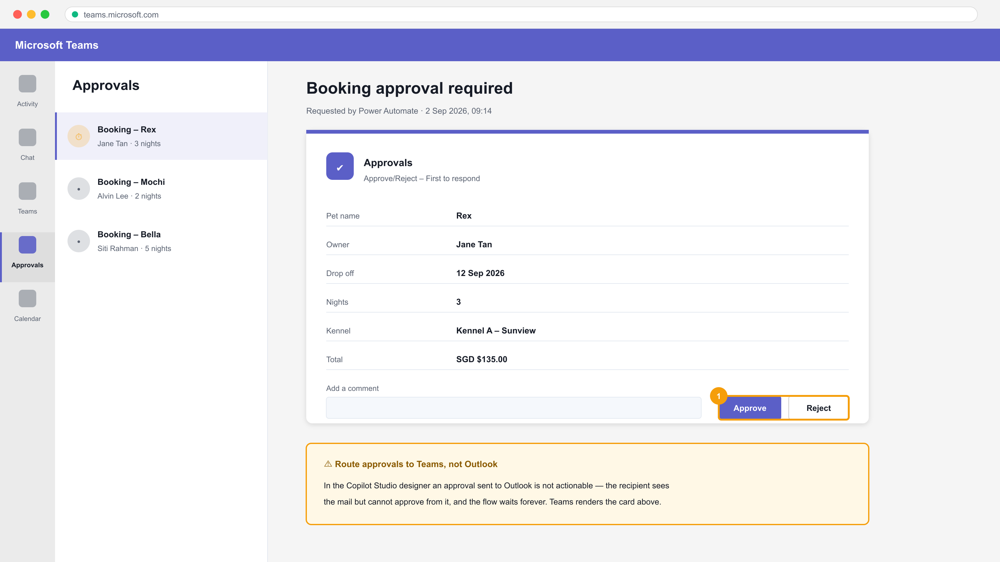

*The approval card in Microsoft Teams — actionable Approve / Reject.*

**Step-by-step**

1. Create an automated cloud flow with the Dataverse trigger 'When a row is added, modified or deleted'.
2. Set Change type to Added, Table name to Booking Requests and Scope to Organization.
3. Add the action Start and wait for an approval; choose Approve/Reject - First to respond.
4. Set the Title using dynamic content, and set Assigned to the manager's account; keep approvals in Teams so they are actionable.
5. Add a Condition comparing the approval Outcome to the literal Approve.

   ```bash
   outputs('Start_and_wait_for_an_approval')?['body/outcome'] is equal to Approve
   ```

6. In the If yes branch add Update a row and set Status to Confirmed; in If no set Status to Declined.
7. Add a Send an email (V2) action in each branch to notify the requester of the decision.
8. Save, then create a Booking Request row to trigger the flow and approve it from the Approvals area or Teams.
9. Open Run history and confirm the Condition took the expected branch.

**Test it**

Approving the request sets the Dataverse row's Status to Confirmed and the requester receives the notification email; rejecting sets Declined.

> **Note:** This lab's folder — labs/lab-14-* — contains the same steps plus the mock data files it needs and three troubleshooting fixes specific to this lab.

---


### Lab 15 — Button Flows and Scheduled Flows

TSC mapping: A3 — Use manual and scheduled triggers, and collect user input at run time.

Goal: Build an instant (button) flow that prompts the user for input and creates a record, then build a scheduled flow that queries rows on a recurrence and emails an HTML summary table.

**What you'll build**

An instant flow with user input and a recurring digest flow that emails a formatted table.   (Services used: Power Automate, Dataverse, Outlook.)

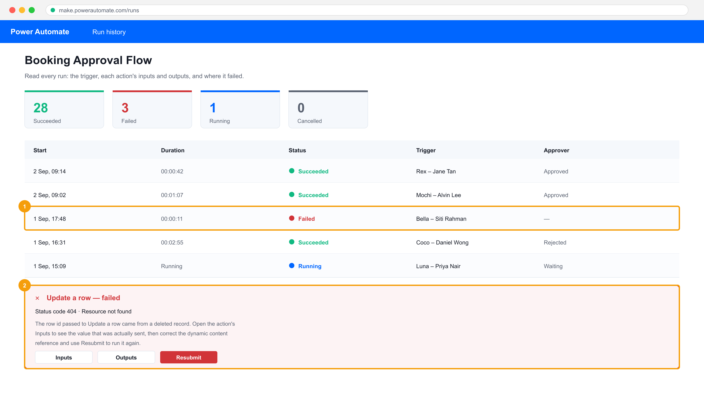

*Run history — the evidence that the connection worked.*

**Step-by-step**

1. Select + Create > Instant cloud flow and choose the trigger 'Manually trigger a flow'.
2. On the trigger add three user inputs: Pet Name (Text), Owner Name (Text) and Drop Off (Date).
3. Add Add a new row for the Booking Requests table and map each column to the matching trigger input.
4. Save and run the flow from the Power Automate mobile app or the Test pane, supplying values; verify the Dataverse row.
5. Create a second flow with + Create > Scheduled cloud flow and set Recurrence to run daily at 08:00 with the time zone set to Singapore.
6. Add List rows for Booking Requests and set the Filter Query to return only pending rows.

   ```bash
   statuscode eq 1
   ```

7. Add Select to project only the columns you need, then Create HTML table over the Select output.
8. Add Send an email (V2) with the HTML table in the body and set Is HTML to Yes.
9. Use Test > Manually to run the scheduled flow now rather than waiting for the recurrence.

**Test it**

The button flow creates a Dataverse row from the values you typed, and the scheduled flow's test run emails a formatted HTML table of pending bookings.

> **Note:** This lab's folder — labs/lab-15-* — contains the same steps plus the mock data files it needs and three troubleshooting fixes specific to this lab.

---


### Lab 16 — Trigger Filters and Cross-Source Integration

TSC mapping: A5/A7 — Stop unnecessary runs with trigger filters and highlight performance issues.

Goal: Add column and row filters to an automated trigger so the flow only runs when it must, then integrate SharePoint, Dataverse and Excel in one flow and compare run counts before and after filtering.

**What you'll build**

A filtered automated flow plus a run-count comparison showing the performance improvement.   (Services used: Power Automate, Dataverse, SharePoint, Excel Online (Business).)


*Comparing run counts before and after adding trigger filters.*

**Step-by-step**

1. Open the Booking Requests table, select the Status column and note its schema name (for example statuscode) — filters use schema names, not display names.
2. Create an automated flow on 'When a row is added, modified or deleted' with Change type Modified.
3. Add a Send an email (V2) action, save, and modify several rows to generate baseline runs; record the run count.
4. Open the trigger's Settings and add the schema name to Select columns so only Status changes fire the flow.

   ```bash
   statuscode
   ```

5. Add a Filter rows expression so only rows moving to Confirmed trigger it.

   ```bash
   statuscode eq 1
   ```

6. Save, repeat the same edits, and record the new run count against the baseline.
7. Add Get items from the SharePoint Kennel Bookings list and Add a row into a table for the Excel log workbook.
8. Run once more and confirm one business event now writes to Dataverse, SharePoint and Excel in a single run.

**Test it**

After filtering, edits to non-Status columns produce no runs, and a single Confirmed change writes to all three data sources in one Succeeded run.

> **Note:** This lab's folder — labs/lab-16-* — contains the same steps plus the mock data files it needs and three troubleshooting fixes specific to this lab.

---


### Lab 17 — Build Your First Copilot Studio Agent

TSC mapping: A1/A3 — Build a conversational agent with instructions and knowledge as a new integration surface.

Goal: In the new Copilot Studio agent designer, create an agent, choose its model, write constraining instructions, attach a SharePoint knowledge source and remove every other source of facts, then probe it for hallucination.

**What you'll build**

A grounded Copilot Studio agent that answers only from your documents and refuses otherwise.   (Services used: Copilot Studio (new agent designer), SharePoint, Dataverse.)

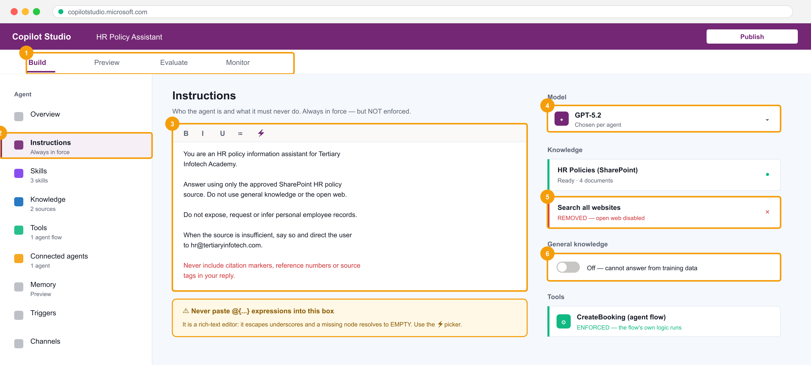

*The new Copilot Studio agent designer — instructions, knowledge, tools and the model picker on one rail.*

**Step-by-step**

1. Open copilotstudio.microsoft.com, confirm the environment matches your flows, and select + Create > New agent.
2. Name the agent HR Policy Assistant and pick the model (GPT-5.x or Claude) from the Model dropdown on the Build tab.
3. Write instructions that state identity, source rule, refusals and escalation — type the prose, never paste @{...} expressions into the rich-text box.
4. Upload the documents in mock-data/hr-policies/ to a SharePoint library, then add that library under Knowledge and wait for the status to reach Ready.
5. Turn OFF general knowledge (Settings > Generative AI) so the model cannot answer from training data.
6. Remove the 'Search all websites' knowledge source — it is on by default and open-web facts are indistinguishable from yours.
7. Add the instruction line: Never include citation markers, reference numbers or source tags in your reply.
8. Open the Preview tab and ask three questions answerable from the documents, then three that are not — record which the agent refuses.
9. Publish the agent and note the Enforced/Not-enforced status of instructions versus knowledge.

**Test it**

The agent answers the in-scope questions from the documents and explicitly declines the out-of-scope ones instead of inventing an answer.

> **Note:** This lab's folder — labs/lab-17-* — contains the same steps plus the mock data files it needs and three troubleshooting fixes specific to this lab.

---


### Lab 18 — Give the Agent a Tool — Calling a Workflow from an Agent

TSC mapping: A4 — Expose a deterministic flow to an agent as a callable tool with typed inputs and outputs.

Goal: Build an agent flow that validates and writes a booking, then register it as a tool on the agent so the conversation can act on the outside world while the enforced logic stays in the flow.

**What you'll build**

An agent that calls a Power Automate flow as a tool and returns the flow's result in chat.   (Services used: Copilot Studio agent flows, Power Automate, Dataverse, Microsoft Teams.)


*Tools on the agent — the agent flow the conversation can call.*

**Step-by-step**

1. In Copilot Studio open your agent, select Tools > + Add a tool > New agent flow.
2. The flow opens with the trigger 'When an agent calls the workflow'; add the input parameters petName (Text), ownerName (Text) and nights (Number).
3. Add a Condition that rejects a nights value above 30 — this validation is enforced, unlike an instruction.
4. In the valid branch add Add a new row to Booking Requests, mapping each input with the dynamic-content picker.
5. Add the 'Respond to the agent' action and return a confirmation message and the created row's id.
6. Save and publish the flow, then return to the agent and confirm the tool is listed under Tools.
7. Write the tool description for the model, not for a developer — it is how the agent decides when to call it.
8. In Preview ask: book a kennel for Rex for 3 nights, owner Jane Tan — and confirm the agent collects the inputs and calls the tool.
9. Probe the boundary: ask for 60 nights and confirm the flow's validation refuses even though the agent tried.

**Test it**

A valid request creates a Dataverse row and returns the confirmation in chat; the 60-night request is refused by the flow's own Condition.

> **Note:** This lab's folder — labs/lab-18-* — contains the same steps plus the mock data files it needs and three troubleshooting fixes specific to this lab.

---


### Lab 19 — Call an Agent from a Workflow with Structured Output

TSC mapping: A4/A5 — Use an Agent node inside a flow and consume its typed fields downstream.

Goal: Build a Power Automate flow containing an Agent node that classifies an incoming request, configure Custom structured output so the result is typed JSON, and branch the flow on the returned fields.

**What you'll build**

A flow whose Agent node returns structured JSON that the following actions branch on.   (Services used: Copilot Studio workflow designer, Agent node, Dataverse, Outlook.)

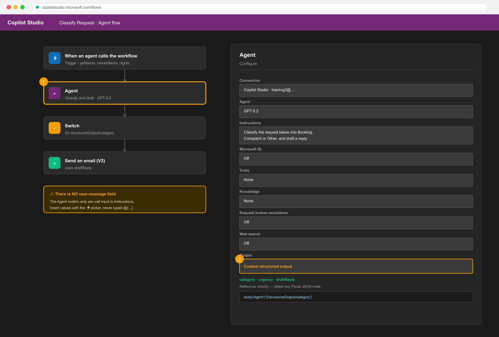

*The Agent node inside a flow, with Custom structured output.*

**Step-by-step**

1. In Copilot Studio select Flows > + New agent flow and add a manual or Dataverse trigger.
2. Add an Agent node; note its Configure tab has Connection, Agent, Instructions, Tools, Knowledge and Output — there is no user-message field.
3. Put the per-call data into Instructions using the lightning-bolt picker to insert the trigger's fields.
4. Set Output to Custom structured output and define a schema with category (string), urgency (string) and draftReply (string).
5. Delete any Parse JSON node — with structured output the fields are referenced directly.

   ```bash
   body('Agent')?['structuredOutput/category']
   ```

6. Add a Switch on the category field with cases for Booking, Complaint and Other.
7. In the Complaint case add Send an email (V2) using the draftReply field, inserting the address with the picker rather than typing it.
8. Save, run the flow with a sample request, and open Run Details > Outputs on the Agent node to read the actual structured output.

**Test it**

The Agent node's Run Details shows the three schema fields populated, and the Switch routes the run to the case matching the returned category.

> **Note:** This lab's folder — labs/lab-19-* — contains the same steps plus the mock data files it needs and three troubleshooting fixes specific to this lab.

---


### Lab 20 — Multi-Agent Handoff and a Human Review Gate

TSC mapping: A5/A7 — Compose connected agents and place a human where the consequence lands.

Goal: Connect a second specialist agent so one conversation can hand off to another with its own knowledge, then add a Request human assistance gate so a consequential action cannot proceed without approval.

**What you'll build**

A two-agent system with a working handoff and a human review gate that blocks the run.   (Services used: Copilot Studio (connected agents), agent flows, Microsoft Teams approvals.)


*Connected agents and the human review gate.*

**Step-by-step**

1. Create a second agent named Finance Assistant with its own knowledge source from mock-data/finance-policies/.
2. Open the HR Policy Assistant and select Connected agents > + Add, then choose Finance Assistant.
3. Write the connection description so the parent knows when to hand off — for example, for questions about claims, reimbursement or budgets.
4. In Preview ask an HR question then a claims question, and confirm the second is answered by the connected agent.
5. Open the booking agent flow from Lab 18 and add Request human assistance before the row is written.
6. Route the approval to Microsoft Teams — Outlook approvals are not actionable in this designer.
7. Publish and run: submit a booking and confirm the flow pauses with a Waiting status until a human responds.
8. Reject the request and confirm no Dataverse row is written, then run again and approve it.
9. Compare the two run histories to show the gate is enforced by the flow, not by the agent's instructions.

**Test it**

The claims question is answered by the connected agent, and a rejected booking leaves no Dataverse row while an approved one does.

> **Note:** This lab's folder — labs/lab-20-* — contains the same steps plus the mock data files it needs and three troubleshooting fixes specific to this lab.

---


## LU4 — Create and Manage Model-Driven Apps with Power Apps and Dataverse

Topics 15–19 · PL-7003 · Tables · Forms · Charts · Solutions

**Key concepts**

- A model-driven app is generated from the Dataverse data model — you configure components rather than draw screens.
- Dataverse tables carry rows, columns, relationships and keys; relationships are one-to-many, many-to-one or many-to-many.
- Forms (Main, Quick View, Quick Create, Card) and views control what a user sees and edits for one row or many.
- Charts and dashboards visualise Dataverse data without code and respect the user's security role and filters.
- Solutions package apps, flows, tables and components so they move between Dev, Test and Production environments.
- Managed vs unmanaged solutions decide whether a target environment can edit the components you shipped.
- Environment strategy plus solutions is how Power Platform middleware modifications reach production safely (TSC A8).
- Troubleshooting integration means isolating the layer — connector, permission, delegation, or data — before changing code.


### Lab 21 — Create Dataverse Tables for a Model-Driven App

TSC mapping: A1/A3 — Model the business domain as Dataverse tables, columns and relationships.

Goal: Working the Contoso Real Estate scenario, create Property and Listing Agent tables with typed columns, a choice column and a lookup relationship, then seed them with data.

**What you'll build**

A two-table Dataverse data model with a relationship and seeded property records.   (Services used: Power Apps, Microsoft Dataverse.)


*The Dataverse table designer for the Property and Listing Agent tables.*

**Step-by-step**

1. In make.powerapps.com select Tables > + New table > Table (advanced properties) and create Property with the primary column Property Name.
2. Add Address (single line of text), Asking Price (currency), Bedrooms (whole number) and Listed On (date only).
3. Add a Choice column Property Type with the options Residential and Commercial.
4. Add a Choice column Status with the options Available, Under Offer and Sold, default Available.
5. Create a second table Listing Agent with the primary column Agent Name and columns Email and Phone.
6. In Property add a Lookup column Listing Agent pointing at the Listing Agent table.
7. Open each table's Data tab and import mock-data/properties.csv and mock-data/listing-agents.csv.
8. Open a property row and confirm the lookup resolves to the correct agent.

**Test it**

Both tables show imported rows, the choice columns render as dropdowns, and each Property row links to a Listing Agent.

> **Note:** This lab's folder — labs/lab-21-* — contains the same steps plus the mock data files it needs and three troubleshooting fixes specific to this lab.

---


### Lab 22 — Build a Model-Driven App

TSC mapping: A3 — Generate an application from the data model rather than drawing screens.

Goal: Create a model-driven app in the modern app designer, add the Property and Listing Agent tables to its navigation, configure the site map, and run the app.

**What you'll build**

A running model-driven app with a two-area site map over the property data model.   (Services used: Power Apps, Microsoft Dataverse, modern app designer.)

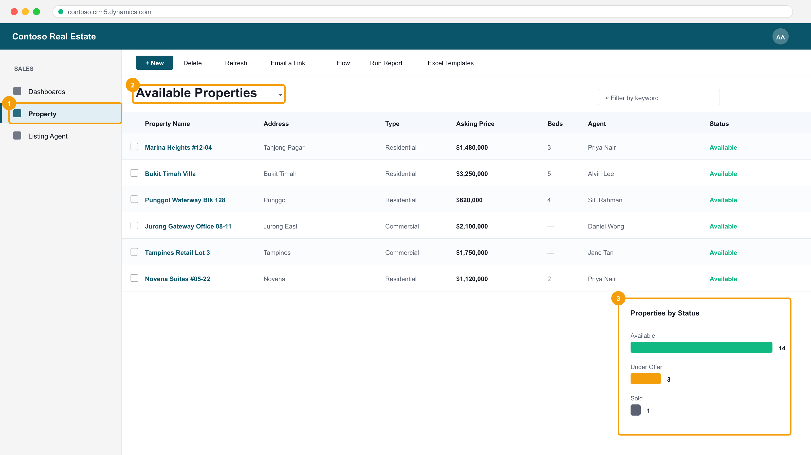

*The running model-driven app — site map, view selector and grid.*

**Step-by-step**

1. Select + Create > Blank app > Blank app based on Dataverse, name it Contoso Real Estate and select Create.
2. In the app designer select + Add page > Table based view and form, then choose the Property table.
3. Add a second table page for Listing Agent.
4. Open the Navigation pane, rename the group to Sales and reorder Property above Listing Agent.
5. Select Save, then Publish, then Play to open the running app.
6. In the running app open the Property area, select a row and observe the generated main form.
7. Create a new property record from the app's + New command and confirm it saves to Dataverse.

**Test it**

The published app opens with Property and Listing Agent in the navigation, and a record created in the app appears in the Dataverse table.

> **Note:** This lab's folder — labs/lab-22-* — contains the same steps plus the mock data files it needs and three troubleshooting fixes specific to this lab.

---


### Lab 23 — Configure Forms and Views

TSC mapping: A3/A6 — Control what each user sees and edits, and verify the layout across the app.

Goal: Customise the Property main form with tabs, sections and a quick view of the related agent, then build filtered and sorted public views the app's users can select.

**What you'll build**

A customised main form with a quick view control, plus two custom public views.   (Services used: Power Apps, Dataverse, form and view designers.)


*Forms and views in the running app.*

**Step-by-step**

1. Open the Property table > Forms and edit the Information main form.
2. Add a second tab named Financials and move Asking Price and Status onto it.
3. On the first tab add a two-column section and arrange Address, Bedrooms and Listed On.
4. Insert a Quick view control bound to the Listing Agent lookup so the agent's email and phone appear inline.
5. Save and Publish the form, then reopen the app and confirm the tabs render.
6. Open the Property table > Views and create a new public view named Available Properties.
7. Add a filter Status equals Available, sort by Asking Price descending, and choose the displayed columns.
8. Create a second view Commercial Listings filtered on Property Type equals Commercial, then Publish.
9. In the running app switch between the views using the view selector.

**Test it**

The main form shows both tabs and the agent's details in the quick view, and both custom views appear in the app's view selector with the correct rows.

> **Note:** This lab's folder — labs/lab-23-* — contains the same steps plus the mock data files it needs and three troubleshooting fixes specific to this lab.

---


### Lab 24 — Create Charts and Dashboards

TSC mapping: A6 — Visualise integrated data to verify the platform is reporting correctly.

Goal: Build charts over the Property table and assemble them into an interactive dashboard inside the model-driven app.

**What you'll build**

Two Dataverse charts and a dashboard surfaced in the model-driven app.   (Services used: Power Apps, Dataverse charts and dashboards.)


*Charts and the dashboard, driven by the same Dataverse rows.*

**Step-by-step**

1. Open the Property table > Charts and select + New chart.
2. Create a column chart named Properties by Status with the legend Count of Property Name and the horizontal axis Status.
3. Create a second chart Average Price by Type using Avg of Asking Price on the legend and Property Type on the axis.
4. Save and publish both charts, then open the app and use the chart pane beside the Property view.
5. In the maker portal select Solutions > your solution > + New > Dashboard > 2-column overview.
6. Add both charts plus a list of Available Properties to the dashboard and name it Sales Overview.
7. Save and publish, then add the dashboard as a page in the model-driven app's navigation.
8. Play the app and select a column in the chart to cross-filter the list beneath it.

**Test it**

Both charts render real counts and averages, and selecting a chart segment in the dashboard filters the associated list.

> **Note:** This lab's folder — labs/lab-24-* — contains the same steps plus the mock data files it needs and three troubleshooting fixes specific to this lab.

---


### Lab 25 — Manage Solutions and Move to Another Environment

TSC mapping: A8 — Package and ship middleware modifications between environments safely.

Goal: Create a publisher and an unmanaged solution, add the app, tables and flows to it, export it as managed, and import it into a second environment.

**What you'll build**

A managed solution package exported from Dev and imported into a second environment.   (Services used: Power Apps, Dataverse solutions, Power Platform admin centre.)

**Step-by-step**

1. In make.powerapps.com select Solutions > + New solution and create a publisher with the prefix tic.
2. Name the solution Contoso Real Estate and set the publisher and version 1.0.0.0.
3. Select + Add existing and add the Property and Listing Agent tables, the model-driven app, the charts and the dashboard.
4. Add the approval flow from Lab 14 to the same solution so the automation ships with the app.
5. Review the solution's Objects list and confirm nothing is missing before export.
6. Select Export solution, choose Managed, and download the .zip package.
7. Switch to the second (Test) environment and select Solutions > Import solution, then upload the .zip.
8. Supply the connection references the import requests, then complete the import.
9. Open the imported app in the Test environment and confirm the components are read-only because the solution is managed.

**Test it**

The managed solution imports into the second environment without errors and its components cannot be edited there.

> **Note:** This lab's folder — labs/lab-25-* — contains the same steps plus the mock data files it needs and three troubleshooting fixes specific to this lab.

---


### Lab 26 — Troubleshoot and Modify Power Platform Integrations

TSC mapping: A7/A8 — Diagnose integration failures by layer and implement the corrective modification.

Goal: Work a set of seeded faults — a delegation warning, a failed flow action, a permission error and a broken connection reference — isolating each to its layer and applying the fix.

**What you'll build**

A troubleshooting log recording each fault, the layer it belonged to, the evidence and the fix applied.   (Services used: Power Apps Monitor, Power Automate run history, Power Platform admin centre, Dataverse.)


*Diagnosing the delegation fault — the formula layer.*

**Step-by-step**

1. Open mock-data/troubleshooting-log.csv — you will record each fault, its layer, the evidence and the fix.
2. In the canvas app add a filter over a large table using a non-delegable function and observe the blue delegation warning.

   ```bash
   Filter('Booking Requests', Len('Pet Name') > 3)
   ```

3. Rewrite the same filter with a delegable expression and confirm the warning clears.

   ```bash
   Filter('Booking Requests', StartsWith('Pet Name', txtSearch.Text))
   ```

4. Open Power Automate > My flows and find a flow with a failed run; open the failed action and read its error message and inputs.
5. Fix the failure — typically a missing dynamic-content reference or an expired connection — then Resubmit the run.
6. Sign in as the shared user from Lab 12, open the app and capture the Dataverse permission error.
7. In the Power Platform admin centre assign the correct security role to that user and confirm the app now loads.
8. Open the imported solution from Lab 25 and repair the broken connection reference in the Test environment.
9. Use Power Apps Monitor while running the app to confirm no failing network calls remain.
10. Complete troubleshooting-log.csv with the layer, evidence and fix for all four faults.

**Test it**

All four faults are resolved — no delegation warning, the flow run succeeds on resubmit, the shared user can open the app, and the connection reference is repaired — with each recorded in the log.

> **Note:** This lab's folder — labs/lab-26-* — contains the same steps plus the mock data files it needs and three troubleshooting fixes specific to this lab.

---


## Troubleshooting Reference

When something does not work, name the layer before you change anything. These are the faults you will meet most often, and they are the same four seeded deliberately in Lab 26.

**Delegation warning (blue triangle in the formula bar)**

The formula cannot be delegated to the data source, so Power Apps processes only the first 500 rows locally and silently returns wrong results on a larger table. Rewrite the formula with a delegable function — do NOT simply raise the data row limit, which only enlarges the local window.

```bash
// NOT delegable — Len() runs on the client
Filter('Booking Requests', Len('Pet Name') > 3)

// Delegable — the server does the filtering
Filter('Booking Requests', StartsWith('Pet Name', txtSearch.Text))
```

**A flow action fails**

Open My flows > the flow > Run history > the failed run. Expand the FIRST failed action and read its Inputs (what it was given) and Outputs (what it returned). 404 means the record id was wrong; 403 means permission; 429 means you are being throttled. Fix the cause, then use Resubmit to re-run with the same trigger data.

**A user can open the app but sees no data**

Sharing an app is not sharing its data. The user needs a Dataverse security role granting read access to the tables, assigned in the Power Platform admin centre. This is deliberate least privilege, not a bug.

**The agent answers questions it should refuse**

Two settings are still on. Turn OFF general knowledge under Settings > Generative AI, and remove the 'Search all websites' knowledge source, which is attached by default. Grounding is as much about removing sources of facts as adding them.

**The agent's reply contains [1] or [doc:turn1doc11] markers**

These are appended by the grounding layer, not written by the model, and asking it not to mention documents will not suppress them. Add an explicit instruction line: 'Never include citation markers, reference numbers or source tags in your reply.'

**Parse JSON fails with "Error parsing NaN value. Path '', line 1, position 1"**

Position 1 means the first character was not a brace — the model returned prose or a fenced code block instead of raw JSON. Set the Agent node's Output to Custom structured output, define the schema, delete the Parse JSON node, and reference the fields directly.

```bash
body('Agent')?['structuredOutput/category']
```


## Assessment Preparation

- Written Assessment (WA): 5 open-ended short-answer questions, 1 hour, open book.
- Practical Performance (PP): 4 hands-on build tasks, 90 minutes, open book.
- The Written Assessment (WA) is open-ended short-answer questions on the concepts — flow anatomy, trigger families, delegation, what is and is not enforced in an agent, solutions and troubleshooting.
- The Practical Performance (PP) is hands-on build tasks in the Power Platform, drawn from the same activities as the labs.
- Both are OPEN BOOK: your slides, this Learner Guide and the lab folders are permitted.
- Re-read each lab's 'Test it' criterion — it states exactly what a correct result looks like.
- Rebuild Labs 7, 14 and 18 from a blank start; those three cover the most assessed skills.
- A minimum of 75% attendance is required to be eligible for assessment and funding.


## Glossary

- **Environment** — The container holding apps, flows, agents and Dataverse data. Everything must share one to see each other.
- **Canvas app** — A pixel-precise app you design control by control and bind to any data source.
- **Model-driven app** — An app generated from the Dataverse data model; you configure components rather than draw screens.
- **Dataverse** — Microsoft's managed data platform — tables, columns, relationships, keys and security roles.
- **Power Fx** — The declarative, Excel-like formula language of canvas apps. A property IS an expression.
- **Delegation** — Pushing filtering and sorting to the data source. A non-delegable formula silently processes only the first 500 rows.
- **Connector** — The middleware that carries data between Power Platform and another system — 1,000+ available.
- **Gallery** — A control that repeats a template for every record in its Items property.
- **Form control** — A control that displays or edits ONE record; committed with SubmitForm().
- **Patch()** — A Power Fx function that writes specific fields to a record, or creates one over Defaults().
- **Collection** — A client-side, in-memory table created with ClearCollect(); it does not write back on its own.
- **Cloud flow** — A Power Automate workflow: exactly one trigger, then ordered actions.
- **Trigger** — What starts a flow. Four families: manual, scheduled, automated and request.
- **Dynamic content** — A token inserting an earlier step's output at run time — always preferred over a typed value.
- **Trigger filter** — Column and row conditions that stop a flow running at all, rather than running and branching.
- **Schema name** — The internal column name (e.g. statuscode) required by trigger filters and Filter Query — not the display name.
- **Approval** — An action that suspends the flow until a person responds, returning an Outcome the flow branches on.
- **Copilot Studio** — The product for building conversational agents with instructions, skills, knowledge, tools and connected agents.
- **Harness** — The orchestration layer around the AI model — context, tools, governance, workflows and security.
- **Agent instructions** — Prose stating identity, source rule, refusals and escalation. Always in force, but NOT enforced.
- **Knowledge source** — Documents an agent may read. The closest thing an agent has to an enforced boundary.
- **Tool (agent flow)** — A Power Automate flow an agent can call. The flow's own logic IS enforced, whatever the agent believed.
- **Connected agent** — A separate agent, with its own knowledge, that a parent agent can hand a conversation to.
- **Structured output** — An Agent node output mode with a typed JSON schema, referenced as structuredOutput/fieldName.
- **PCF** — Power Apps Component Framework — the TypeScript API for building custom code components.
- **Solution** — A package of apps, flows, tables and components that moves between environments.
- **Managed solution** — A solution whose components cannot be edited in the target environment. Ship managed, develop unmanaged.
- **Security role** — The Dataverse permission set that decides which rows a user may read or write.
